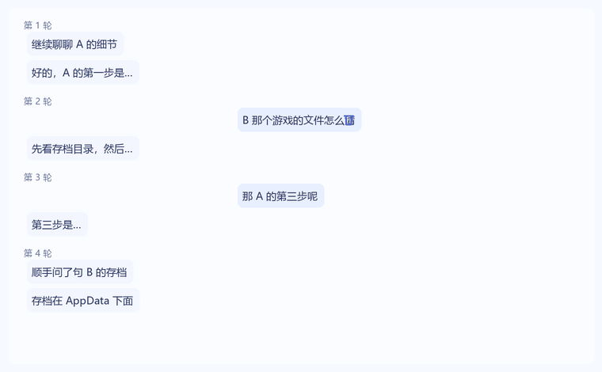

# dsh-turn-delete

[中文](README.md) · English

Delete **one finished turn** from a DeepSeek Harness session — from the model context only. The Session, its id, title, workspace link, later turns and the append-only event log all stay.

The case it exists for: you were talking about A, accidentally asked something about B, and that turn now rides along in every request — poisoning attention and burning tokens. This plugin makes that one turn invisible to the model, and to nothing else.

- Kernel: DeepSeek Harness `0.1.7`+ and all of `0.2.x` (verified on `0.2.2-rc.3`)
- Runtime: Web profile or a Web-based desktop shell, Node 22.19+
- License: MIT



> Redrawn from the real interaction (trash → confirm → the turn leaves the context); not a screen recording. Generator: `tools/make-demo-gif.py`.

## Features

- **Many turns at once**: the trash icon opens selection mode; click any floor to pick it (blue ring plus shadow), click again to drop it, then delete everything selected from one fixed bottom bar.
- **Real removal, not a mask**: the turn leaves `session.deriveMessages()`, which is the only source of every request.
- **Immediate** on DeepSeek providers; other adapters fall back to "applies from your next message" automatically.
- **Log untouched**: deletion appends one surface-replacement event; the original prompt, answers and tool records stay auditable and replayable.
- **Never touches the system prompt** (surface node 0 stays outside every replaced span).
- **Refuses instead of corrupting**: open turns, compacted turns, and turns carrying the active system prompt are rejected with a reason.
- **Idempotent**, plus three recovery tools for damaged or missing sessions.

## Install

```sh
# local directory (development)
dsh plugin --profile desktop add -w link:/abs/path/dsh-turn-delete

# from GitHub
dsh plugin --profile desktop add github:Kingsir111/dsh-turn-delete
```

Restart DSH (or the desktop app) after installing, or enable `dsh-turn-delete` in the plugin panel.

## Use

1. Hover the action row of any finished turn's last assistant reply and click the trash icon: selection mode opens.
2. Click any floor in the transcript to select it (blue ring plus shadow); click it again to clear it. Pick as many turns as you want.
3. Click **Delete** in the fixed bottom bar, review the confirmation dialog, then confirm.
4. Those turns leave the model context and their floors are hidden.

`Esc` or **Exit** leaves selection mode. Turns that cannot be removed (open, compacted, carrying the system prompt) cannot be picked and are refused by the API with a code. The button is disabled while the task runs; deletion is idempotent.

A removed floor can reappear after archiving and unarchiving a session. That is visual only — the context stays clean. See [Known issues](#a-deleted-turn-comes-back-after-archiving-and-unarchiving-the-session).

| Adapter | Timing | Carrier |
|---|---|---|
| `deepseek-*` | immediately | empty `user/message` surface replacement |
| anything else | from the next message | empty `system/message` replacement inside the next open step |

Session format v4 only admits message events inside an open turn/step, so a system tombstone cannot be written right after a turn ends. An empty user message is legal there, and the DeepSeek serializer drops it (`serialize.ts:123`) — other adapters would send it, hence the fallback. Details: [docs/DESIGN.md](docs/DESIGN.md).

## Refusals

`TURN_NOT_CLOSED`, `TURN_COMPACTED` (already folded into a summary), `TURN_PROTECTED` (carries the active system prompt), `TARGET_NOT_FOUND`.

## Compatibility

Verified by replaying one real 1907-event / 19-turn log against each installed kernel: `0.1.7-rc.2`, `0.2.0-rc.1`, `0.2.1-rc.5`, `0.2.2-rc.3` all produce identical spans, identical derived-history deltas and identical tombstones, and stay idempotent. `0.1.5.x` is designed for but untested (those kernels reject v4 logs); `<= 0.1.0` is unsupported.

## Limits

- Finished top-level turns only; subagent sessions show no button.
- Visual hiding of a deleted turn is anchored on the plugin's own action button, with framework attributes and text fragments as fallbacks. The kernel exposes no per-turn visibility hook, so the context deletion itself does not depend on it.
- Facts repeated in other turns still exist there — correctly.

## Known issues

### A deleted turn comes back after archiving and unarchiving the session

Reproduce: delete a few turns, archive the session, unarchive it — those turns appear in the transcript again. Refreshing the page does the same.

This is visual only. The model still receives history without those turns; the deletion itself holds.

**Why the transcript shows what the model no longer sees.** Two different projections of one append-only log:

| Layer | Source | Result |
|---|---|---|
| Model context | The surface projection of the event log (`deriveMessages()`), which applies `surfaceOp` replacements | replaced spans never reach the request → **removed** |
| Transcript | The client's own chat node list | every `append` event becomes a node; there is no "drop these spans" path → **still shown** |

In the kernel's `dsh-client-ui-chat`, a `user/message` renders when `isAppendSurfaceEvent(event) && !isCompactionCheckpoint(event)`, and `isCompactionCheckpoint` matches exactly a `user/message` carrying a non-append `surfaceOp` — the tombstone shape this plugin writes. The tombstone is therefore drawn as a compaction checkpoint, while the original append events were never removed. That bundle contains no `endSeq`, so it does not consume replacement spans at all.

Archiving only rebuilds the view from stored events, which is why the result matches a page reload. Nothing about archiving rewrites the log.


## Docs

- [Design and kernel evidence](docs/DESIGN.md)
- [Test report](docs/TEST-REPORT.md)
- [Changelog](CHANGELOG.md)
- [Contributing](CONTRIBUTING.md)

## License

[MIT](LICENSE)
