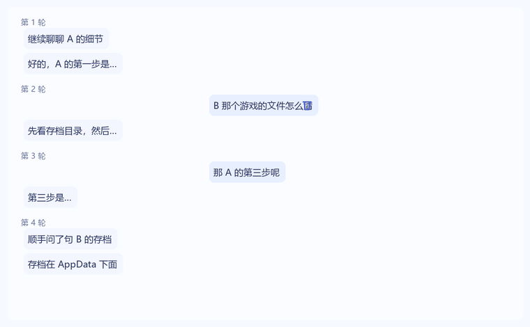

# dsh-turn-delete

在 DeepSeek Harness 的会话里**删掉一整轮对话**——只删上下文，不删会话、不改日志。

你在聊 A 的时候手滑问了件 B 的事，那一轮会永久留在模型上下文里，之后每次请求都带着它：污染注意力、白烧 token。这个插件让那一轮从**后续模型上下文**中消失，而 Session id、标题、工作区、之后的轮次、以及 append-only 的原始事件日志全部保留。

每个已结束的轮次，其助手回复的操作行里会出现一个垃圾桶图标，点两下即可。

- 内核：DeepSeek Harness `0.1.7` 起、`0.2.x` 全线（当前实测 `0.2.2-rc.3`）
- 运行环境：Web profile 或基于 Web 的桌面套壳，Node 22.19+
- 许可：MIT



> 上图按真实交互重绘（垃圾桶 → 确认 → 该轮从上下文消失），非屏幕录制；重绘脚本见 `tools/make-demo-gif.py`。

---

## 特性

- **真删除，不是隐藏**：被删轮次从 `session.deriveMessages()` 中消失，而那是每次请求的唯一来源。
- **当场生效**：DeepSeek 适配器下点击即生效；其它适配器自动降级为「下一次提问起生效」。
- **不动日志**：日志是 append-only 的，删除只追加一条表面替换事件；原始提问、回答、工具记录仍可审计、可回放。
- **不碰系统提示**：surface 节点 0（system prompt）永远留在替换区间之外。
- **拒绝而不是写坏**：轮次未结束、已被压缩折叠、或携带「当前生效的系统提示」时，插件明确拒绝并说明原因。
- **幂等**：同一轮重复删除不会写第二条墓碑。
- **自带救援工具**：日志损坏可修、会话从侧栏消失可取回（见「故障恢复」）。

## 安装

三种方式任选。

**1. 直接链接本地目录（开发/自用）**

```sh
dsh plugin --profile desktop add -w link:/绝对路径/dsh-turn-delete
```

**2. 从 GitHub 安装**

```sh
dsh plugin --profile desktop add github:Kingsir111/dsh-turn-delete
```

**3. 桌面版手动放置**

把整个目录拷到 profile 的插件目录，并在 `package.json` 的 `dsh.profile.bundles` 里加上 `dsh-turn-delete`，然后重启应用。

安装后重启 DSH（桌面版重启应用），或在插件面板里启用 `dsh-turn-delete`。

## 使用

1. 找到那一轮**最后一个**助手回复，鼠标悬停到操作行，点垃圾桶。
2. 就地出现「删除 / 取消」，点「删除」。
3. 该轮立刻隐藏并标注「此轮已从上下文删除」。刷新、重启都不会回来。

任务运行期间按钮置灰。删除是幂等的。

### 生效时机

| 当前模型适配器 | 生效时机 | 载体 |
|---|---|---|
| DeepSeek（`deepseek-*`） | **点击即刻** | 空内容的 `user/message` 表面替换 |
| 其它适配器 | 下一次提问起 | 下一个开启 step 内的空 `system/message` 替换 |

原因见 [设计说明](docs/DESIGN.md)：会话格式 v4 要求消息类事件匹配一个**开启**的 turn/step，所以空 system 墓碑没法在已结束的轮次后立刻写；而空 user 消息虽然合法，只有 DeepSeek 序列化器会把它从请求里丢掉（`serialize.ts:123`），换别的适配器就会多出一条空消息，因而降级。

## 拒绝的情况

插件宁可拒绝，也不写一条会让会话变坏的记录：

| 情况 | 错误码 | 表现 |
|---|---|---|
| 这一轮还没结束 | `TURN_NOT_CLOSED` | 无法删除 |
| 已并入压缩摘要 | `TURN_COMPACTED` | 摘要整体替换，无法单独摘除一轮 |
| 携带当前生效的系统提示 | `TURN_PROTECTED` | 删掉会让后续请求丢失系统提示 |
| 消息不存在/会话不活跃 | `TARGET_NOT_FOUND` | 这一轮已变化 |

## 机制（一句话版）

模型可见历史是事件日志经 `surfaceOp` 投影出来的「表面」。删除 = 追加一条**空内容消息**（不产生任何 wire 消息）把目标轮在表面上的连续区间替换掉，并在 `sourceEventSeqs` 里列全被遮蔽的节点。日志一个字节都没改。

细节、内核源码行号、载体实验见 [docs/DESIGN.md](docs/DESIGN.md)；完整测试记录见 [docs/TEST-REPORT.md](docs/TEST-REPORT.md)。

## 兼容性

同一份真实会话日志（1907 事件 / 19 轮）在已安装的多个内核版本上重放：

| 内核 | 删除结果 |
|---|---|
| `0.1.7-rc.2` / `0.2.0-rc.1` / `0.2.1-rc.5` / `0.2.2-rc.3` | **通过**，区间、派生历史变化、墓碑形状完全一致，且幂等 |
| `0.1.5-rc.2/rc.3` | 未实测（该版本拒收 v4 日志）；代码按 `header.version<4` 自动改写 source |
| ≤ `0.1.0` | 不支持：无 `createSystemMessage`、surface 事件不能携带 `surfaceOp`、replace 键名是 `start/end` |

`peerDependencies` 声明 `^0.1.5-rc.2 || ^0.2.0-rc.1`，刻意不写 `engines.dsh`——它一旦存在会覆盖 peers 单独裁决。

## 已知限制

- 只对**顶层、已结束**的轮次生效；subagent 会话不显示按钮。
- 「已删除」的视觉隐藏以**插件自己渲染的按钮**为锚点（不依赖皮肤属性），另有框架属性、文本片段两级兜底。内核没有公开的整轮可见性扩展点；**即使这层隐藏失效，模型上下文的删除依然成立**。
- 删除不回收 token 计量记录，也不改写历史统计。
- 若同一件事在别的轮次也说过，那里仍在（这是正确的）。

## 已知问题

### 归档后再取消归档，已删轮次会重新显示（但不会进入记忆）

**复现**：删除若干轮 → 归档该会话 → 取消归档 → 这些轮次又出现在对话里。

**影响**：纯视觉问题。模型收到的历史里没有它们，删除本身没有失效。刷新页面也会出现同样现象。

**原因：模型和界面读的是两层不同的投影。**

| 层 | 数据来源 | 结果 |
|---|---|---|
| 模型上下文 | 事件日志经 `surfaceOp` 投影后的「表面」（`deriveMessages()`） | 被替换区间不进入请求 → **已删** |
| 对话界面 | 客户端自己的聊天节点列表 | 每个 `append` 事件生成一个节点，没有「按区间摘除节点」的路径 → **仍显示** |

内核 `dsh-client-ui-chat` 里，`user/message` 的渲染条件是 `isAppendSurfaceEvent(event) && !isCompactionCheckpoint(event)`；而 `isCompactionCheckpoint` 判定的正是「`user/message` + 非 append 的 `surfaceOp`」——也就是本插件写入的墓碑形状。于是墓碑被当成**压缩检查点**渲染，而原先那些追加事件从未被移除。该客户端包里搜不到 `endSeq`，说明它并不消费替换区间。

归档/取消归档只是让视图**从存储的事件重新构建**一次，所以结果与刷新页面一致。日志始终是追加的，归档没有改写任何东西。

**插件做了什么**：用插件自身渲染的按钮作锚点做尽力隐藏，失败时宁可不隐藏也不会隐藏错楼层。隐藏是呈现增强，不是删除本体。


## 故障恢复工具

内核处于 developer preview，格式规则会收紧。插件把一个早期设计写坏过一个会话（详见 [CHANGELOG](CHANGELOG.md)），因此附带三个手工工具，全部默认干跑、`--apply` 才写、写前备份：

| 工具 | 用途 |
|---|---|
| `tools/repair-log.mjs` | 摘掉日志尾部违规行，救回「历史加载失败」的会话 |
| `tools/clone-session.mjs` | 用新 id 克隆一个会话（逐字节保留内容） |
| `tools/write-session-log.mjs` | 按指定 id 把解包日志落盘（恢复 Host 内存中的会话） |

```sh
# 先解包（多帧 zstd 需要系统 Node 26；Electron 的 Node 24 只解第一帧）
node test/unpack.mjs "<session.v4.jsonl.zstd>" session.json

# 干跑 → 确认 → 写入
node tools/repair-log.mjs "<session.v4.jsonl.zstd>"
node tools/repair-log.mjs "<session.v4.jsonl.zstd>" --apply
```

## HTTP 接口（可脚本化）

```sh
# 删除某一轮（202 = 已登记或已生效）
curl -s -X POST http://127.0.0.1:<port>/dsh-turn-delete \
  -H 'content-type: application/json' \
  -d '{"sessionId":"session-…","assistantMessageId":"…"}'

# 查询某会话的删除状态
curl -s 'http://127.0.0.1:<port>/dsh-turn-delete/deleted?sessionId=session-…'

# 救援：把一个解包日志创建成新的活动会话
curl -s -X POST http://127.0.0.1:<port>/dsh-turn-delete/import \
  -H 'content-type: application/json' \
  -d '{"jsonPath":"/绝对路径/session.json","title":"恢复"}' 
```

成功均返回 `{"ok":true,"value":…}`；失败返回 `{"ok":false,"error":{"code","message"}}`，状态码见上表。

## 开发与测试

```sh
# 纯前端/契约测试，无需内核
node test/client-register.mjs

# 跨版本矩阵：需要 ../compat-matrix/v-<version>/node_modules 下的内核副本
node test/matrix.mjs <log.json>

# 宿主全流程：需要能解析 @deepseek-ai/* 的 node_modules（目录联接即可）
ELECTRON_RUN_AS_NODE=1 "<DSH_NODE_EXECUTABLE>" test/host-flow.mjs <log.json>
```

测试脚本默认不接受真实用户日志，需要先用 `test/unpack.mjs` 解包；`.testdata/` 已加入 `.gitignore`。

贡献前请读 [CONTRIBUTING.md](CONTRIBUTING.md) 里的三条不变量。

## 许可

[MIT](LICENSE)
